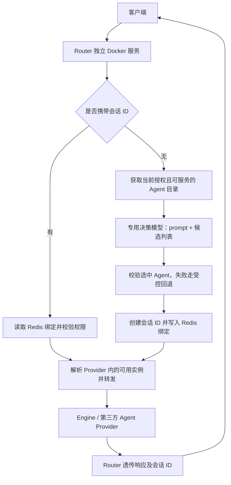

# Router 独立容器部署与新会话智能选 Agent

> 本文是早期需求与设计记录。请求协议已改为标准 OpenAI / Anthropic 接口，下文中的 `/api/v1/agent/*`、`context.conversationId`、`X-Conversation-Id` 已被取代，现行行为以[部署文档](deployment.md)和[下游接入接口](downstream-api.md)为准。

状态：方案已确认，首版实现随本 PR 提交。下文现状分析记录实现前的基线；运行配置与已交付行为以[部署文档](deployment.md)为准。

已确认：显式指定 Agent 跳过模型；会话 ID 由 Router 生成；未知会话 ID 直接返回 404，不探测归属、不隐式创建。采用 Router 专用决策模型连接及受控默认 Agent 回退。

## 1. 已明确的需求

1. Router 作为独立 Docker 服务构建、发布、部署，通过网络与 Engine、第三方 Agent Provider 和决策模型通信。
2. 用户请求没有携带会话 ID 时，Router 根据本次 prompt 和当前可用 Agent 列表，调用决策模型，决定转发到哪个 Agent。
3. Router 负责选择和转发，Agent 负责实际执行用户任务；普通 HTTP 和流式请求采用相同的选择规则。
4. 结合仓库既有约束：已有会话保持亲和，不因后续 prompt 改变而重新选 Agent；共享状态保存在 Redis，多副本 Router 不依赖本机状态。

“独立部署”指独立镜像和进程，不代表不需要 Redis、认证服务、Agent Provider 或模型服务。Router 不引用 Engine 项目，不承担 Agent 执行、工具运行或对话历史存储。

## 2. 现状与差距

以下结论来自本仓库代码，不假设 OpenAgent 主仓库已经实现额外接口。

| 方面 | 当前实现 | 本需求需要补齐的部分 |
| --- | --- | --- |
| 容器 | 根目录已有多阶段 [Dockerfile](../Dockerfile)，发布 Router 项目，监听 5001；已有 `.dockerignore` | 可复现的部署样例、生产配置说明、非 root 运行验证、探针、独立镜像发布流程 |
| 请求解析 | `message` 为 prompt；JSON 从 `context.conversationId` 读会话，也支持 `X-Conversation-Id` 和表单；支持显式 Agent | 定义空值、字段冲突、首次会话创建和会话 ID 返回规则 |
| Agent 目录 | `AgentCatalogService` 聚合 Provider，经过访问控制过滤；重复 Agent ID 返回冲突 | 明确发布状态、健康与权限有效性；确认跨 Provider 的目录契约 |
| 新会话选择 | `AgentSelectionService` 已执行“候选列表 → 意图选择 → 默认 Agent 回退” | 明确无会话 ID 的产品语义，补齐独立决策模型配置与完整验收 |
| 决策调用 | `IntentAgentSelector` 委托 Provider；Engine Provider 调用 `/api/v1/agent/chat/intent`，传入候选 ID、名称、描述和用户消息 | 目前依赖 Engine 中的 `intent-router`，并要求请求带 `llmProfileId`；没有该字段会抛异常。应使用 Router 的专用决策模型配置 |
| 会话亲和 | Redis 保存 `ProviderId + Pending/Confirmed`；已有会话会探测 Provider 归属 | 未保存选中 Agent；无会话 ID 时不建立绑定，也未在转发层补录下游新会话 ID |
| 未知会话 ID | Provider 均报告不存在时，当前仍可能进入新会话选择 | 需明确与“已有会话不重新选择”的边界，避免拼错 ID 时悄悄新建 |
| 降级 | 意图超时、HTTP 失败等可返回空选择后回退；目录和决策还共用外层超时预算 | 外层超时可能直接返回 503，部分异常会继续抛出；需拆分预算并统一预期失败的回退行为 |
| 权限与状态 | ACL 从 Redis 读取；缺失或读取失败时可能放行，缓存没有失效机制；未配置 Redis 时使用进程内缓存 | 明确生产授权边界和 ACL 更新方式，不能把 Redis 故障当成授权成功；生产会话状态必须共享 |
| 缓存与重试 | 查询缓存位于选路之前；非流式幂等响应只保存状态、类型和响应体，流式请求跳过幂等中间件 | 新会话不能因相同 prompt 命中响应缓存而跳过选择；幂等重放须返回同一会话 ID 和选路响应头 |
| 就绪检查 | `RouterReadyCheck` 检查 Redis 情况和默认 Engine 路由，Redis 异常可视为降级 | 应覆盖实际配置的 Provider 与新会话必需依赖，支持专用决策模型和第三方 Provider |

主要证据入口：

- [请求解析与选择入口](../src/OpenAgent.Router/Endpoints/AgentSelectionFilter.cs)、[选择服务](../src/OpenAgent.Router/Endpoints/AgentSelectionService.cs)
- [意图选择器](../src/OpenAgent.Router/Endpoints/IntentAgentSelector.cs)、[Engine Provider](../src/OpenAgent.Router/Providers/OpenAgentEngineProvider.cs)
- [目录服务](../src/OpenAgent.Router/Routing/AgentCatalogService.cs)、[ACL 服务](../src/OpenAgent.Router/Security/AgentVisibilityService.cs)
- [会话解析](../src/OpenAgent.Router/Routing/ConversationProviderResolver.cs)、[亲和记录](../src/OpenAgent.Router/Models/ConversationProviderAffinity.cs)、[转发器](../src/OpenAgent.Router/Endpoints/AgentForwarder.cs)
- [运行时注册](../src/OpenAgent.Router/Extensions/RouterServiceCollectionExtensions.cs)、[缓存策略](../src/OpenAgent.Router/Middleware/RouterCachePolicy.cs)、[幂等中间件](../src/OpenAgent.Router/Middleware/IdempotencyMiddleware.cs)

## 3. 推荐架构



这里有两个不同的选择：先根据语义选定 `AgentId + ProviderId`，再在该 Provider 内选择可服务实例。现有 Redis 服务发现、一致性哈希与健康隔离用于后者，不能代替模型选择 Agent。Provider 必须保证所选实例能服务该 Agent；不能只按通用 `chat` 能力选实例而忽略 Agent 的实际部署位置。

### 3.1 决策模型归属

| 方案 | 特点 | 建议 |
| --- | --- | --- |
| 继续调用 Engine 的 `intent-router` | 改动较小，复用现有模型管理；部署时仍需配置该决策 Agent 和服务端决策 profile | 可作为过渡适配器 |
| Router 通过专用模型客户端调用模型服务或模型网关 | 决策连接独立配置，业务 Agent 可以来自不同 Provider，客户端无需提供决策模型信息 | 推荐目标方案 |

独立 Docker 部署本身并不强制采用第二种方案；推荐它是为了让 Router 的选路职责与业务 Agent Provider 解耦。具体模型厂商、协议与模型名称待选定，不在本次文档中预设。

复用 `IIntentAgentSelector` 作为选择边界，新增 Router 内部决策模型客户端；业务 `IAgentProvider` 负责目录、会话适配与转发。保留 Engine 意图适配时，也必须由服务端配置专用决策 profile，不能借用客户端的 `context.llmProfileId`。后者如存在，只影响实际任务执行。

## 4. 建议的请求行为

本节行为已经确认。

| 输入 | 建议行为 | 是否调用决策模型 |
| --- | --- | --- |
| 无会话 ID，无显式 Agent | 校验 prompt，获取候选，调用模型，校验结果，创建绑定，转发 | 是，即使只有一个候选，首版也保持一致 |
| 无会话 ID，有显式 Agent | 保留现有显式指定能力；验证授权与可用性后创建绑定 | 否，作为显式覆盖入口 |
| 有已知会话 ID | 读取绑定，校验该用户对会话及 Agent 的权限，转发到原 Agent | 否 |
| 有会话 ID，同时显式指定相同 Agent | 按原绑定转发 | 否 |
| 有会话 ID，同时显式指定不同 Agent | 返回 409，禁止通过此入口切换会话 Agent，包括同 Provider 内切换 | 否 |
| 有会话 ID，但无绑定 | 直接返回 404，不向 Provider 探测，也不调用模型或创建新会话 | 否 |
| prompt 为空或只有空白，且需要自动选择 | 返回 400；附件本身不能在首版充当路由 prompt | 否 |

新会话 JSON 示例，沿用现有字段名，不新增 `prompt` 别名：

```json
{
  "message": "帮我分析这份订单的退款原因",
  "context": {}
}
```

后续请求示例：

```json
{
  "message": "再按产品类别汇总",
  "context": {
    "conversationId": "router-issued-conversation-id"
  }
}
```

会话 ID 缺失、`null`、空串或空白统一视为未提供；分别规范化请求体与请求头后取有效值。两个有效来源不一致时返回 400，Agent ID 的多个来源同理，避免选择层和转发层使用不同值。

建议响应统一返回 `X-Conversation-Id` 和现有的 `X-OpenAgent-Selected-Agent-Id`，后续请求继续携带会话 ID。浏览器跨域调用需要在 CORS 中暴露这两个响应头；流式响应也必须在写入首个事件前确定 ID 和绑定。

## 5. 候选目录与模型决策

### 5.1 “可用 Agent”的定义

候选必须同时满足：所属 Provider 可服务、Agent 已发布且启用、当前租户和用户有权限、目录信息有效、该 Provider 能保证后续会话亲和。首版继续要求跨 Provider 的 Agent ID 唯一，出现冲突返回 409，不让模型解决标识冲突。

Provider 的目录响应是用户可见列表的基础，Router 的 ACL 可进一步收紧权限。必须先明确各 Provider 的租户与授权契约；ACL 查询失败不能被解释成“没有限制”。目录缓存如需要加入，须按租户和权限范围隔离、有明确有效期，并支持权限变更失效。

`AgentSummary` 已有 ID、名称、描述、状态和版本。已核对 Engine 与本仓库共享枚举，`AgentPublishStatus.Published` 的值为 2；Engine Provider 据此并按租户过滤。首版给模型传 ID、名称和能力描述；新增结构化能力标签须另行确认共享契约。

### 5.2 模型输入输出

输入仅包括路由任务指令、用户本次 `message` 和过滤后的候选摘要。首版不解析附件正文、不读取历史会话、不做多 Agent 编排。限制 prompt、单条描述、候选总量和模型输出大小；超限须明确报错或走配置好的回退，禁止静默截掉候选后假装完成全量选择。

建议继续采用结构化结果：

```json
{
  "agentId": "order-analysis",
  "confidence": 0.92
}
```

Router 必须验证结果可解析、Agent ID 属于本次候选、置信度是有限数字且位于 `[0, 1]` 并达到阈值。阈值是路由策略参数，模型自报置信度不代表经过校准的正确率。Provider 和目标地址由 Router 从候选映射取得，模型无权生成目标 URL。

用户消息和 Agent 描述均作为数据处理，不得覆盖选择规则。路由模型只做选择，不运行工具、不创建业务对话，也不执行用户任务。

### 5.3 超时与回退

保留现有 `MinimumConfidence=0.5` 与决策调用 `TimeoutMs=5000` 作为首版建议起点；目录获取、模型决策、Redis 写入和业务转发分别有界，端到端预算必须给回退和写入留出时间。客户端取消直接终止，不启动回退任务。

| 情况 | 建议处理 |
| --- | --- |
| 模型超时、网络错误、限流、无有效结果、格式错误、低置信度、输出非候选 ID | 仅回退到配置的默认 Agent，且该 Agent 必须在当前授权、可用候选中 |
| 没有可用候选，或回退 Agent 不在候选内 | 返回 503，不随机选择、不绕过权限 |
| 决策连接配置无效或缺失 | 启动校验失败，不以运行时 500 掩盖配置问题 |
| 新会话无法持久化绑定 | 返回 503，不发送可能无法恢复会话归属的业务请求 |
| 已有会话的 Agent / Provider 暂不可用 | 返回 503；可在同 Provider 内选择能服务原 Agent 的健康实例，不重新选 Agent |
| 原 Agent 已撤销或用户已失去权限 | 拒绝访问，不回退到其他 Agent |
| 已开始转发或流已输出后失败 | 返回/记录转发失败，不自动重发到其他 Agent，避免重复执行副作用 |

生产建议保留受控回退并记录 `selectionSource=model/fallback/explicit/conversation`，以区分真实模型决策与降级结果。

## 6. 会话生命周期与幂等

首版采用转发前建立不可改写的选路绑定。Router 生成 UUID，使用 Redis `SET NX` 原子写入按租户与会话 ID 隔离的记录；内容包含版本、Provider、Agent、用户与固定到期时间。默认保留 30 天，转发失败不解除绑定，后续仍去原 Agent。记录中的 `Confirmed` 表示路由归属确定，不表示下游任务已经执行成功。

未知 ID 直接返回 404；过期、墓碑、不同用户、旧版本不含 Agent / 用户的记录也不允许续聊。会话 ID 本身不是授权凭证；每次请求仍验证 Agent 权限和 Provider 可用性。生产不允许退回本机内存状态。

已核对当前 Engine 的请求映射与会话存储流程，它接受调用方在请求头或 `context.conversationId` 传入的 ID；Router 同时规范化这两个来源。第三方只有明确接受并复用调用方 ID 才进入候选；原生 ID 自动映射留作后续扩展，不在本版隐式启用。

会话查询、删除、压缩与交互记录接口也通过同一绑定定位原 Provider，无法支持相应操作的 Provider 返回 501。删除先保存墓碑，再调用下游，避免删除失败后旧 ID 重新创建对话；下游可能残留的数据需要单独清理。跨 Provider 的会话列表聚合与文件互通不在首版范围。

聊天入口移除普通查询响应缓存。JSON 非流式幂等重放保留同一会话及选路头，并重新校验会话授权；流式首次响应前记录原会话，重复流返回 409 和原会话 ID，不重放流内容。幂等存储不可用时拒绝请求。表单不支持幂等重放，业务执行恰好一次仍依赖下游契约。

生产 Redis 需要持久化和备份。绑定丢失后只能拒绝旧 ID，不能根据 prompt 重选恢复；旧版本会话迁移需显式另行设计。

## 7. 独立 Docker 部署交付

本 PR 交付内容（操作步骤见部署文档）：

- 保留并完善根目录 `Dockerfile`，从本仓库独立构建镜像；验证非 root 运行、优雅停机、HTTP/SSE 流式转发及健康探针。
- 增加 `deploy/compose.yaml` 和配置说明，用 Router + Redis 展示独立运行；Engine / 第三方 Provider、身份服务和模型网关为明确配置的外部服务。
- 示例使用容器可解析的服务地址，避免 `localhost:5208` 这类宿主机开发默认值。明确 Redis 地址、Provider 地址、认证配置、默认 Agent、专用决策模型连接与超时预算。
- 密钥通过部署系统的 Secret 或只读配置挂载注入，不写入镜像和仓库；普通设置支持环境变量。生产必需配置在启动时校验。
- 存活探针表示进程可响应；就绪探针反映 Redis 和实际 Provider 是否能支持目标路由能力。模型故障但存在有效回退时标记降级，不能因为决策模型故障阻断仍可服务的已有会话；探针不通过付费模型推理探测健康。
- 新增镜像构建与发布流程，使用可追溯版本标签；Compose 仅为部署样例，具体生产镜像仓库和发布平台另定。

新增 `RouterSettings:DecisionModel` 表达 Endpoint、密钥来源和输入输出限制；`IntentRecognition` 表达启用开关、阈值、目录/决策超时和回退 Agent。旧 `ProviderId/AgentId` 不再参与选择，具体配置以部署文档为准。

生产不允许悄悄退回进程内会话存储。Redis 服务发现故障时，静态路由仍可帮助找到实例，但不能替代会话绑定持久化或授权所需状态。

## 8. 实施顺序与验收

实现按以下依赖顺序组织，并通过同一 PR 提交：

1. **契约与生命周期**：确定 ID 生成/返回、显式 Agent 优先级、未知 ID 行为；完成 `Provider + Agent` 绑定、恢复及幂等元数据，验证 Engine 兼容性。共享 Contracts 或 Engine 接口变更须在两边对齐。
2. **独立决策链路**：增加专用模型配置与客户端，复用选择服务和目录过滤；补齐输出校验、超时预算、默认回退、选路指标，避免新会话响应缓存绕过选择。
3. **容器交付**：补充 Compose、生产配置、探针与镜像流程，在真实 Redis、多 Router 容器和模拟/真实 Provider 下联调。

| 验收场景 | 通过标准 |
| --- | --- |
| 无会话 ID 的正常请求 | 用至少两个能力不同的 Agent 验证；模型收到用户 prompt 和授权候选，所选 Agent 及 Provider 与实际转发一致 |
| 决策连接隔离 | 请求不带 `llmProfileId` 也能选择；客户端执行模型配置不改变 Router 决策模型 |
| 会话续聊 | 拿首次返回的 ID 发明显不同意图的消息，仍去原 Agent，决策模型调用数不增加 |
| 单候选和显式指定 | 单候选自动路由仍调用模型；显式指定按最终确认的覆盖规则执行 |
| 权限和异常输出 | 越权 Agent 不进入模型输入；未知 ID、非有限置信度、低置信度及格式错误不能绕过候选验证 |
| 模型故障 | 超时、网络错误、限流等按策略回退；回退不可用返回 503；总耗时符合预算 |
| 未知或冲突会话 | 未知 ID 直接返回 404，存储不可用返回 503，切换已绑定 Agent 返回 409，不触发模型 |
| 多副本与重启 | 首次请求在 A，续聊在 B 或重启后的 A，仍能从 Redis 恢复相同绑定；并发绑定不分叉 |
| Redis 与 ACL 故障 | 不创建缺少可靠绑定的新会话，不把 ACL 读取失败当授权成功 |
| HTTP/SSE 与重试 | 两种传输选择一致；流式首字节前绑定完成；非流式幂等重放保留会话响应头；重复流请求行为明确，无跨 Agent 重发 |
| 容器独立启动 | 从本仓库构建并用部署样例运行，不依赖 Engine 源码目录或宿主机开发地址；存活/就绪行为符合依赖状态 |

实现时执行 `dotnet build OpenAgent.Router.sln`、`dotnet test OpenAgent.Router.sln`，补充上述行为测试和容器集成验证。具体测试结果记录在 PR 中；真实模型供应商与第三方 Provider 联调按部署配置另行执行。

## 9. 已确认的实现选择

1. **模型调用路径**：Router 直连专用模型服务/网关，首个适配采用 OpenAI 兼容 Chat Completions HTTP 接口；不依赖 Engine 决策 Agent，也不使用客户端执行模型 profile。
2. **显式 Agent**：新会话显式指定 Agent 时跳过模型，仍须验证授权与可用性；已有会话禁止更换 Agent。
3. **会话 ID**：Router 生成、Redis 保存 Provider 与 Agent 绑定；未知、过期或不属于当前用户的 ID 返回 404，不进行归属发现或重选。
4. **回退与 Provider**：采用受控默认 Agent 回退；首版完整会话生命周期以接受调用方会话 ID 的 OpenAgentEngine 为验收目标。第三方需显式确认此协议后启用，不承诺原生 ID 自动映射。
5. **会话记录**：首版在转发前建立不可改写的选路绑定，默认保留 30 天；不使用会导致续聊重选的短期 Pending 过期策略。删除后保留拒绝访问的墓碑至原过期时间，未知 ID 始终拒绝。
